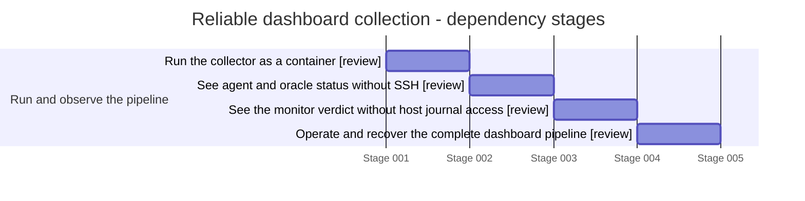

# Reliable dashboard collection

Last reconciled: **2026-10-12T09:59:16.398Z**. Team: **RUNNING**. [Milestone](https://github.com/lambdasistemi/moog-antithesis-dashboard/milestone/3).

Ownership recovery in progress. Existing candidates are preserved; implementation staffing and acceptance remain pending. Wiki publication is blocked because the wiki Git repository is unavailable.

> Stories describe outcomes; tickets are delivery containers. The mapping is many-to-many. Unticketed work, decisions and standing obligations are named explicitly. A landed enabler does not mean the product outcome is delivered.

## Delivery map

**Dependency-stage Gantt — not a calendar forecast.** Each equal-width bar occupies one dependency stage; positions are calculated from the prerequisites below. Synthetic dates are rendering coordinates only. Widths are not effort, duration or completion percentages. Standing obligations are checkpoints. Same-stage rows may be independent, but this chart grants no dispatch authority.

Labels report delivery state; only in-progress rows use active colouring.

State key: **landed/delivered** = evidence linked; **review/ready** = not landed; **blocked/decision** = unresolved prerequisite; **planned** = not commissioned; **standing** = continuing obligation.

## Run and observe the pipeline

| Story | Kind | Tracking | State | Owner |
|---|---|---|---|---|
| [Run the collector as a container](#collector-runtime) | enabler | Ticketed — [#10](https://github.com/lambdasistemi/moog-antithesis-dashboard/issues/10) | review | Epic #14 owner — recovery roster pending; milestone desk owns routing |
| [See agent and oracle status without SSH](#role-status) | enabler | Ticketed — [#11](https://github.com/lambdasistemi/moog-antithesis-dashboard/issues/11) | review | Epic #14 owner — recovery roster pending; milestone desk owns routing |
| [See the monitor verdict without host journal access](#freshness-status) | enabler | Ticketed — [#12](https://github.com/lambdasistemi/moog-antithesis-dashboard/issues/12) | review | Epic #14 owner — recovery roster pending; milestone desk owns routing |
| [Operate and recover the complete dashboard pipeline](#deployed-evidence) | operation | Ticketed — [#13](https://github.com/lambdasistemi/moog-antithesis-dashboard/issues/13) | review | Epic #14 owner — recovery roster pending; milestone desk owns routing |

### Run the collector as a container

**As Pipeline operator, I want run the collector as a container, so that A reliable public dashboard with safe operational data.**

**Tracking:** Ticketed. Preserved child of architecture epic #14; existing PR remains a candidate. [#10](https://github.com/lambdasistemi/moog-antithesis-dashboard/issues/10).

**Now — review:** Existing PR #15 has successful hosted checks at the recovered head; acceptance and deployed evidence have not been recovered.

**Acceptance:** The CI-built container runs repeated collection and publication with mounted-file secrets.

**Dependencies:** No prerequisite story recorded; this is not dispatch authority.

**Next:** Recover ticket evidence and staffing before execution or acceptance.

**Evidence:** [PR #15](https://github.com/lambdasistemi/moog-antithesis-dashboard/pull/15)

### See agent and oracle status without SSH

**As Pipeline operator, I want see agent and oracle status without ssh, so that A reliable public dashboard with safe operational data.**

**Tracking:** Ticketed. Preserved child of architecture epic #14; existing PR remains a candidate. [#11](https://github.com/lambdasistemi/moog-antithesis-dashboard/issues/11).

**Now — review:** Existing PR #17 has successful hosted checks at the recovered head; acceptance and deployed evidence have not been recovered.

**Acceptance:** Agent and oracle push validated status; their last good values become visibly stale on interruption.

**Dependencies:** [Run the collector as a container](#collector-runtime)

**Next:** Recover ticket evidence and staffing before execution or acceptance.

**Evidence:** [PR #17](https://github.com/lambdasistemi/moog-antithesis-dashboard/pull/17)

### See the monitor verdict without host journal access

**As Pipeline operator, I want see the monitor verdict without host journal access, so that A reliable public dashboard with safe operational data.**

**Tracking:** Ticketed. Preserved child of architecture epic #14; existing PR remains a candidate. [#12](https://github.com/lambdasistemi/moog-antithesis-dashboard/issues/12).

**Now — review:** Existing PR #18 has successful hosted checks at the recovered head; acceptance and deployed evidence have not been recovered.

**Acceptance:** The monitor pushes its verdict and the collector preserves its independent freshness.

**Dependencies:** [See agent and oracle status without SSH](#role-status)

**Next:** Recover ticket evidence and staffing before execution or acceptance.

**Evidence:** [PR #18](https://github.com/lambdasistemi/moog-antithesis-dashboard/pull/18)

### Operate and recover the complete dashboard pipeline

**As Pipeline operator, I want operate and recover the complete dashboard pipeline, so that A reliable public dashboard with safe operational data.**

**Tracking:** Ticketed. Preserved child of architecture epic #14; existing PR remains a candidate. [#13](https://github.com/lambdasistemi/moog-antithesis-dashboard/issues/13).

**Now — review:** Existing PR #19 has successful hosted checks at the recovered head; acceptance and deployed evidence have not been recovered.

**Acceptance:** A deployed end-to-end run and stop/restart controls prove the pipeline and operator recovery.

**Dependencies:** [See the monitor verdict without host journal access](#freshness-status)

**Next:** Recover ticket evidence and staffing before execution or acceptance.

**Evidence:** [PR #19](https://github.com/lambdasistemi/moog-antithesis-dashboard/pull/19)

## Maintenance

This page and its Gantt are generated from the adjacent story register. The milestone owner must reconcile it on material state changes and before handoff. Updating the timestamp alone is not reconciliation. A normal debrief reads this page; an authorised state sweep updates and publishes it. If publication is blocked, the desk must name the stale publication and pending changes.

Register schema: `milestone-stories/v1`. Parsed-register SHA-256: `e2f90385e1f1d8053d7904678dd6b454eb53819573f693f30d28a209ec71c935`.

<!-- Generated by debrief/scripts/render-milestone.mjs; edit the JSON register, then regenerate. -->
