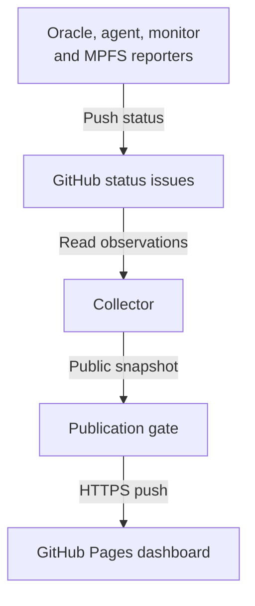
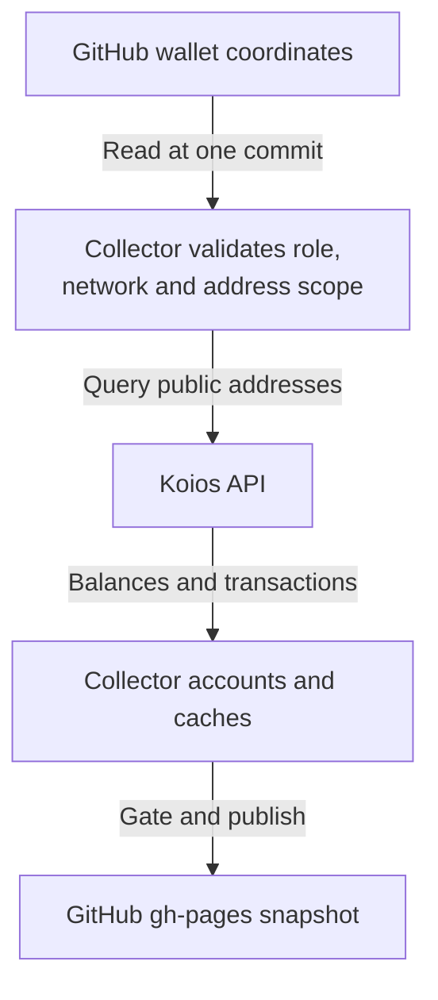

# Dashboard collection and publication design

## Who this is for

As the pipeline operator, I open the dashboard to see service health, test
progress and remaining ADA. I can inspect GitHub to see the service observations
and the public configuration that tells the collector which wallets to query.
When a source fails, I see its last successful observation and its age; an
unavailable wallet is never displayed as a zero balance.

This revision records the operator's corrected design. Oracle, agent and monitor issue
reporting is deployed. Dedicated MPFS reporting follows the independent-instance
contract below. Historical wallet accounting remains open,
tracked in [MPFS status](https://github.com/lambdasistemi/moog-antithesis-dashboard/issues/29),
[agent/oracle funds](https://github.com/lambdasistemi/moog-antithesis-dashboard/issues/23)
and [requester funds](https://github.com/lambdasistemi/moog-antithesis-dashboard/issues/24).
Current Koios balance collection uses config/wallets.json, read through the
GitHub API at a recorded commit, and renders oracle, agent and cfhal account
cards. It supports preprod, validates provider address coverage, and sums
integer lovelace without floating-point arithmetic. A null chain_point records
that address_info responses are not bound to a known exact chain point.
The diagrams describe the data flow, not a production deployment receipt.

## System context

The service diagram shows reporter-produced observations. The wallet flow below
shows the collector querying an external API using public GitHub coordinates.
Antithesis is queried directly by the same collector for test observations.

GitHub holds two distinct inputs: producer observations and public query
coordinates. Koios and Antithesis are peer external APIs called directly by the
collector. Koios supplies chain observations; Antithesis supplies test
observations. Neither needs a separate host reporter or a GitHub issue containing
its entire API response. The resulting public wallet data lives with the
collected snapshot on the repository's gh-pages branch and dashboard.

GitHub Actions runs and receipts are additional GitHub API inputs. Existing
Moog facts/token reads through legacy MPFS and the Antithesis proxy readiness
probe remain deployed sources until a separately verified replacement exists.
A successful proxy probe is not MPFS health. Do not silently substitute the newer
umpfs service for the legacy MPFS used by deployed Moog.

## Wallet coordinates and collection

The versioned public configuration contains a schema version and, for each
wallet, a stable identifier, role, explicit Cardano network, active and historical
public address scope, and the evidence establishing its association with the
running role or requester. A requester username alone is insufficient. Testnet
addresses do not distinguish preprod from preview; verify the deployment network
independently before choosing Koios. Address rotation preserves prior addresses.

The collector reads this configuration from GitHub at a recorded commit, validates
its schema and address/network scope, then chooses the supported Koios network
endpoint from its own allowlist. Configuration cannot supply arbitrary endpoints,
commands, wallet-file paths or private keys. Unknown fields and malformed,
unsupported or empty address sets fail that source. Pin the configuration
revision for a whole collection cycle, including every page of history.

The collector queries Koios directly, using the configured addresses. It computes
in integer lovelace, records provider and observation time and available chain
point, and publishes formatted ADA balances and evidence-backed history. Shared
addresses are visible and not double-counted. Fees, top-ups, transfers, internal
change and known locked/refundable funds are separate; unresolved attribution
remains unclassified. Partial pagination remains incomplete, never lifetime
spending. The accounting acceptance criteria in the funds tickets remain binding.

A missing configuration or failed Koios call retains the last-good observation
with its original scope/revision and an explicit stale marker. After a scope
change, old observations remain labelled with the old scope and cannot stand in
for a successful query of the new scope. No balance is published until the role
mapping, network and provider observation have been verified.

## Host status publication

Oracle, agent, monitor and MPFS publish allowlisted JSON to dedicated status
issues. Oracle and agent sample every minute and write only on meaningful changes
or a five-minute heartbeat. Each MPFS instance follows that contract with its own status issue and report timestamp. The monitor's one-shot
push hook must be invoked by its existing producer within the freshness window.

The MPFS reporter records the configured service's container state, image and
bounded read-only API probe outcome. It never publishes probe response bodies.
Container running, API reachable and chain synchronized are separate claims;
synchronization stays unmeasured without an established observation and reference.

The collector independently validates each issue body: exact known keys, bounded
strings and counts, correct role, UTC producer timestamp, no future date and no
observation older than fifteen minutes. Schema validation limits what gets
published; it does not authenticate the truth of a report. Anyone with issue-edit
rights can replace a body. GitHub Issues-write applies to the repository, not a
single issue. Docker socket access is privileged even in a read-only container.

## Freshness and recovery

Every source keeps its own last-good value. A failed query marks that source stale;
without any successful observation it is unavailable. Producer timestamps define
host observation age. Koios observation time defines wallet age; rereading GitHub
coordinates or republishing a snapshot cannot refresh a failed chain query.

The central backend is native Babashka: source adapters, validation, cache,
snapshot assembly, publication and the loop run in Clojure. External clients
are invoked with argument vectors; credentials travel on stdin or only in the
relevant child's environment. Compatibility shell files only launch bb.

Antithesis property results follow every pagination cursor and share one complete
population between summary and detail. A failed later page leaves the result
unavailable, never complete with a truncated count. Completed nonempty property
sets use the new cache generation; old partial property/detail caches are ignored.
Counts include API groups and events, not distinct bugs. On-chain records cover
all public requesters in the configured MPFS state. Detail and summary joins
use requester, platform, repository, directory, commit and try, and are refreshed from current facts
even when Antithesis data is immutable. The recent-record limit never removes
records needed by visible runs. GitHub workflow receipts appear independently
in Pipeline; calendar dates and testnet names do not establish a launch link.
Last-good source values and timestamps form one atomic cache record;
legacy records remain readable during the transition.

The collector loops every ten minutes. Publication passes a secret gate before
HTTPS push to gh-pages. The browser polls the snapshot every minute and warns
when it is older than twenty-five minutes. Losing the cache loses last-good
values, so sources are unavailable until fresh queries succeed.

## Trust boundaries and credentials

The collector has no SSH, wallet files, mnemonic, signing keys, host journal or
inbound receiver. Reporters have no listening port and publish only public facts.
Secrets enter as read-only mounted files; never as build arguments, image
contents, container environment, process arguments or public output. Antithesis
private report links are removed before publication.

Nix builds both images without a Docker daemon. Deploy immutable merged-SHA tags,
preserve the named cache volume, and restore the previous Nix-built Compose
service for rollback. Never restore the legacy timer or run two publishers.
The runbook's token scopes are recommendations; deployed broader operator tokens
are not certified least-privilege by this design.

## Decisions

| Chosen | Alternative | Reason |
|---|---|---|
| GitHub stores public wallet query coordinates | Host wallet reporters publish balances to issues | Chain data is available through Koios, just as tests are available through Antithesis; keep collection in one place. |
| Collector calls Koios and Antithesis directly | Stage both API responses in GitHub issues first | Avoid a second collection stage and its independent freshness/credential lifecycle. |
| Host reporters publish service status to issues | Collector SSH or a public receiver | Host observations stay on the producing host; GitHub supplies transport without a new inbound service. |
| Publish derived wallet observations in the gh-pages snapshot | Separate mutable balance status issues | Reuse the established atomic snapshot and publication gate while retaining inspectable GitHub output. |
| Allowlisted provider selection from an explicit network | Arbitrary URL from public configuration | Public input cannot redirect credential-bearing or internal requests. |
| Independent last-good values and explicit coverage | Zero on failure or spending inferred from outputs | Preserve the evidence and its limits when dependencies fail. |

## Delivery and verification

The [runbook](runbook.md) distinguishes installed sources from planned sources.
The [front page](../README.md) explains how to inspect the live snapshot.
MPFS requires reporter/schema/heartbeat/stale/recovery and deployment evidence.
Wallet collection requires public configuration controls, verified production
role mapping and network, exact balance fixtures, pagination and accounting
controls, independent provider reconciliation and final hosted checks.

Current balances are implemented; historical accounting and the MPFS reporter
remain future collection paths.
Existing direct Moog reads remain visible; their replacement needs its own scope
and verification. Monitor cutover, MPFS reporting and historical wallet coverage
stay open until their production evidence is recorded.
