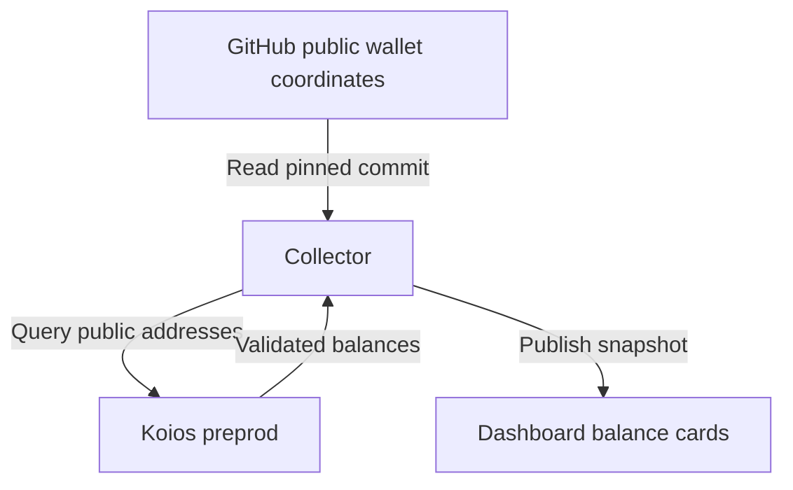

# Pipeline status and wallet balance slice

## User story

As the pipeline operator I scan consistent status cards and see oracle, agent
and cfhal ADA balances. Stale observations are labelled stale rather than healthy.
I can expand technical details without long image names crowding the summary.

## Collection flow

This slice implements current balances, public coordinates, provider validation,
exact lovelace arithmetic and stale recovery. Historical expenses, historical
address census, locked-fund accounting and independent matching-point validation
remain open in issues23/24. It does not close those issues.

The network and role mappings were established in their discovery receipts.
GitHub schema validation and provider response validation refuse unknown fields,
unsupported networks, missing/duplicated addresses and invalid balances. Raw
wallet material is never read by the collector. A failed provider/configuration
read retains explicitly stale observations and their original address scope.

## Verification

Known multi-address fixtures check exact sums, including integers beyond JS
floating-point precision. Missing addresses and malformed balances refuse.
Provider outage preserves last-good time and balance; recovery refreshes both.
Rendered cards use the service container rather than its reporter and refuse
healthy labels for stale sources. Desktop/mobile light/dark views are inspected.
