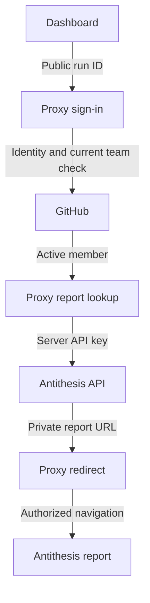

# Open authorized Antithesis reports

## User stories

As a dashboard reader, I open a report from its run row in a new tab and keep
my dashboard context. GitHub sign-in and active Pragma team membership control
disclosure of the report URL. I can reach the proxy account page to sign out.
Public browsing continues when a report is missing, pending or refused.

## Data flow

## Acceptance

- Each row with a valid Antithesis run ID has an Open report action.
- On-chain-only rows have no invented report destination.
- Run IDs use the deployed proxy's ASCII letters, digits, hyphen and underscore
  contract, with a maximum length of 128. Invalid IDs create no report link.
- User-activated links open a top-level tab with no referrer and no opener.
- The dashboard performs no authenticated fetch and retains no user token,
  report URL or private response in application storage or telemetry.
- Team access text and the proxy account/sign-out entry are discoverable.
- An explicitly labelled prototype demonstrates simulated access outcomes.
- Phone and desktop browsing, details and persistent preferences keep working.

## Verification

Execute the actual row renderer with valid, invalid, pending and fact-only
inputs. Exercise row navigation, account navigation and prototype states in a
browser, including phone layout and return to unchanged dashboard context.
The backend has a genuine operator-confirmed successful member report opening;
denied-account and full deployed acceptance remain separate in ticket 39.

## Boundaries

This integrates the deployed browser contract at backend candidate dcb2561e.
It does not change credentials, token custody, membership policy or API schema.
The proxy currently holds user tokens in RAM sessions and issues opaque cookies;
there is no session database. Report URLs remain capabilities after disclosure.
Backend merge and real negative-account acceptance are not implied by this UI.
