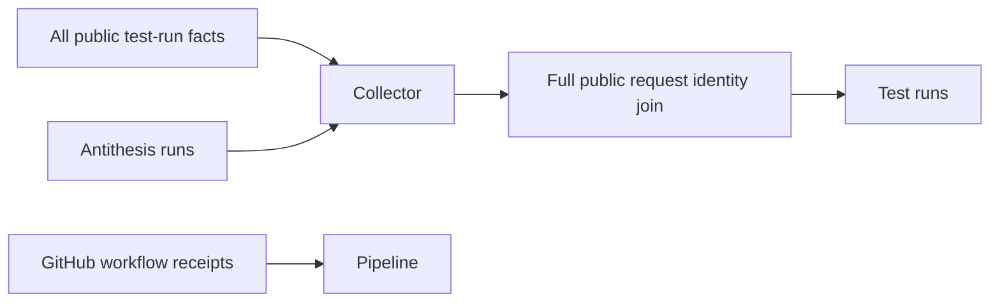

# Accurate test-run context

## User stories

As a dashboard reader, I see the public on-chain record for a test regardless
of who requested it. Repeated Antithesis executions may share that record.
Property descriptions start folded so the result table remains readable.
GitHub workflow activity appears separately in Pipeline, with no inferred
association to a test merely because both ran on the same date.

## Data flow

## Acceptance

- Query all public test-run facts without a requester filter.
- Keep requester identity in published facts and in summary/detail matching.
- Keep the latest thirty facts plus every fact needed to match a visible run.
- Match repeated executions to their shared record without losing identity.
- Report unavailable coverage separately from a measured absence.
- Fold descriptions closed without opening counterexamples when toggled.
- Render workflow receipts independently of testnet names and test dates.
- Keep private report material excluded and preserve existing source isolation.

## Verification

Execute backend regression checks and the existing site/schema gates. Verify
the live snapshot matches the previously missing wolf31o2 and saratomaz runs,
using the same public facts source. Local fixtures do not prove live coverage.
