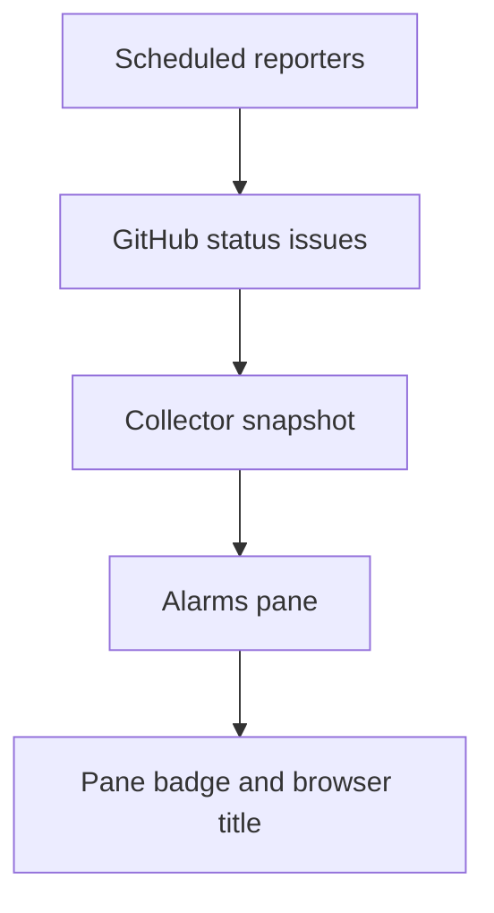

# Fresh status feeds and visible alarms

## User story

As a dashboard operator, open Alarms to see current source and service problems and the same count in the pane badge and browser title. A healthy MPFS deployment with a pinned digest continues to publish accepted observations.

## Data flow

Reporters retain the existing minute comparison and five-minute heartbeat. The MPFS image boundary permits only the known registry and image, a tag and an optional full sha256 digest. Monitor publication remains attached to the declared scheduled check and keeps its existing notification behavior.

## Alarm rules

Count one alarm per source when its status is not healthy or its last success is over fifteen minutes old. Prefer freshness over retained service values. Fresh monitor failures, proxy unavailability, down oracle/agent containers, agent error observations and unhealthy MPFS API/container/readiness states also produce one alarm per affected source. Do not invent a lag threshold or count test assertion failures.

A snapshot older than twenty-five minutes and an unsuccessful browser refresh are distinct dashboard alarms. Missing initial data is unavailable, never healthy. Counts and titles clear when current data recovers. The selected pane persists and first visits still open Test runs.

## Acceptance

Execute a digest-pinned MPFS reporter regression, image/privacy negative controls, collector validation, actual UI alarm computation and preference tests. Check the declared monitor command and its live GitHub publication. Verify automatic feed timestamps, hosted CI, native images and the deployed page at320/390px.

## Boundaries

Preserve credentials, report authorization, public snapshot shape and on-chain state. This change adds no notification channel and changes no MPFS or node version. Infrastructure timer wiring is a separate scoped PR linked to the same delivery issue.
